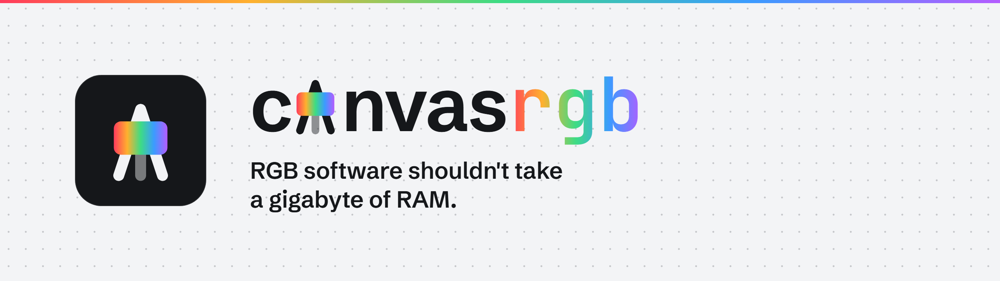
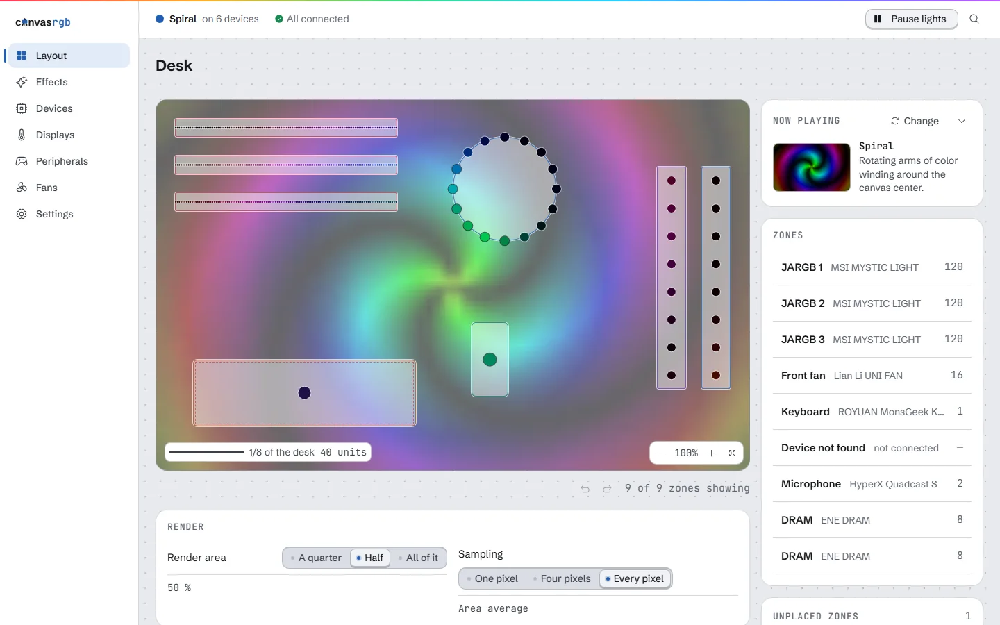

<picture>
  <source media="(prefers-color-scheme: dark)" srcset="docs/assets/banner-dark.png">
  
</picture>

[](https://github.com/iAmChumby/canvas-rgb/actions/workflows/ci.yml)
[](LICENSE)


**RGB software shouldn't take a gigabyte of RAM.** That changes now. canvas-rgb runs your lights,
fans, mouse and controller in a fraction of the memory.

[Download v0.1.0](https://github.com/iAmChumby/canvas-rgb/releases/latest) ·
[Site](https://iamchumby.github.io/canvas-rgb/)

## 819 MB before. 55 MB now.

| Same PC (Ryzen 7 7800X3D, Windows 11), one app at a time, 60 s each | RAM | CPU | Disk |
|---|---|---|---|
| **canvas-rgb**: lights, fans, pump display, mouse, controller | **55 MB** | **0.5%** | **117 MB** |
| SignalRGB, ZEUS CAST and the Attack Shark X6 app | 819 MB | 2.6% | 2.4 GB |
| Signal alone, with its background service switched off | 643 MB | 0.7% | 1.8 GB |

Canvas was driving the fan curves the whole time it was measured. The 8BitDo app never made the
table, so the real gap is wider. The editor adds about 360 MB while its window is open and gives
it back when you close it. Method and caveats live in [docs/benchmark.md](docs/benchmark.md).

## Your Signal effects run here

Same HTML files, drawn in Rust by an embedded script engine with no browser underneath. Drop one
into `%APPDATA%\canvas-rgb\effects\` and the daemon loads it within five seconds. Or run
`canvas-rgb effects import my-effect.html`, which checks the file before it copies it in.
[docs/effects.md](docs/effects.md) lists exactly which calls work.

## Lighting

Every device sits on one layout, so an effect paints across the whole case as a single picture.
Fourteen effects ship built in. Eleven are the classics, from solid colour to screen ambience and
audio spectrum. The other three paint the case: Ink Drop unfurls ink through still water, Wet
Smear drags thick pigment into streaks, and Palette Knife lays colour on in slabs.

<picture>
  <source media="(prefers-color-scheme: dark)" srcset="site/public/shots/layout-dark.webp">
  
</picture>

## Fans

Curves, fixed speeds or BIOS control on each header, saved as named profiles. If the service shuts
down, panics or loses a temperature sensor for too long, BIOS gets every fan back. No fan is ever
driven below its floor. Fan control runs on the NCT6687D chip through the
[PawnIO](https://github.com/namazso/PawnIO) driver.

## Mouse and controller

The Attack Shark X6 and 8BitDo Ultimate 2 apps can stay closed for good. Canvas sets the X6's DPI,
polling rate, lighting and power options, and maps the Ultimate 2's paddles and buttons along with
its stick and trigger ranges.

## For developers

- A local API on `127.0.0.1:9430`. Every route except status and the live preview needs the API
  token.
- The `canvas-rgb` CLI talks to that same API: `status`, `devices`, `effects`, `output`, `fans`,
  `peripherals`, `diag` and `config`. Add `--json` and a script can read any of it.
- New devices are adapters, a Rust module behind the `DeviceAdapter` trait in
  `crates/canvas-proto/src/traits.rs`. [docs/adapters.md](docs/adapters.md) walks through one.
- An effect is one HTML file. `canvas-rgb effects check my-effect.html` tells you whether it parses,
  moves and shows more than one colour before you install it. The repo ships a Claude Code skill
  for writing them in `.claude/skills/canvas-rgb-effect`.

## Install

Grab `canvas-rgb-setup-0.1.0.exe` from the
[latest release](https://github.com/iAmChumby/canvas-rgb/releases/latest) and run it. Windows flags
an unknown publisher the first time, because the installer isn't signed yet.

Setup looks for Signal and PawnIO first and only asks about what it finds or misses. Its
uninstaller hands the fans back to BIOS before it removes a single file. For a silent install:

```powershell
canvas-rgb-setup-0.1.0.exe /SILENT /SIGNALRGB=Y /PAWNIO="C:\path\PawnIO_setup.exe"
```

### Developer build

Run the plan first. It prints every step and changes nothing.

```powershell
powershell -ExecutionPolicy Bypass -File installer\setup.ps1 -WhatIf
powershell -ExecutionPolicy Bypass -File installer\setup.ps1
```

One admin prompt. The script builds canvas-rgb, downloads OpenRGB and checks its SHA-256 before
anything runs. Fan control needs PawnIO, which isn't bundled: pass the installer you downloaded
with `-PawnIoInstaller`. `installer\uninstall.ps1` hands every fan back to BIOS, then removes the
service, the install folder and the startup entries.

To build the setup wizard yourself, run `tools\build-installer.ps1` with Inno Setup 6 installed.

## Hardware

Canvas is built and tested on an MSI B850 board with Mystic Light ARGB and an NCT6687D fan chip,
ENE RAM, a MonsGeek keyboard, a HyperX QuadCast S, a GAMDIAS CHIONE pump display, an Attack Shark
X6 and an 8BitDo Ultimate 2. Lighting goes through [OpenRGB](https://codeberg.org/OpenRGB/OpenRGB),
so what OpenRGB supports should light up here too.

Something wrong on your rig?
[Open an issue](https://github.com/iAmChumby/canvas-rgb/issues/new/choose) with the steps, what you
expected and what you saw.

## Why Canvas exists

Signal and ZEUS CAST ran every day on the PC this was built for, one for the lights and one for the
pump display, and between them they held most of a gigabyte. The 8BitDo and Attack Shark apps were
bad enough that they never got opened, so the paddles and the mouse settings sat out of reach.

A gaming PC should spend its memory on games. Canvas took over every one of those jobs and runs
them in 55 MB.

## Thanks

Most of this hardware never shipped with docs. OpenRGB, Hypercolor, PawnIO, ATKsoft, the 8BitDo
Linux project, SDL and others cracked it first, and Canvas builds on what they found.
[docs/thanks.md](docs/thanks.md) credits each one.

## License

Apache-2.0. [NOTICE](NOTICE) lists the code and research Canvas builds on.
